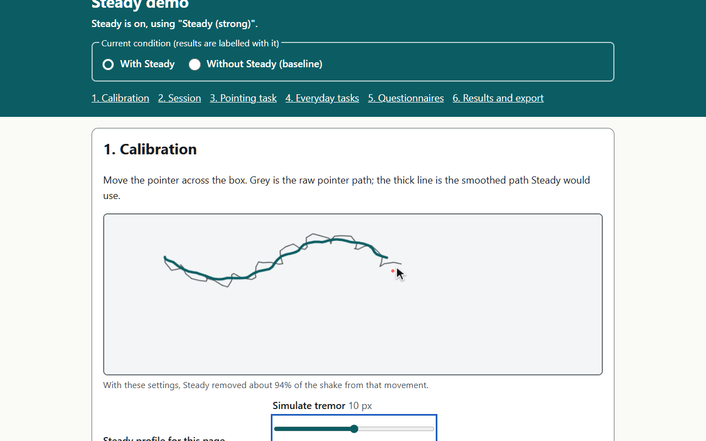
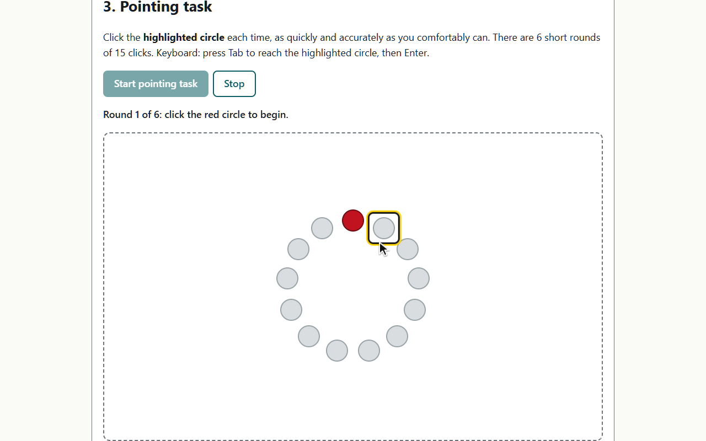
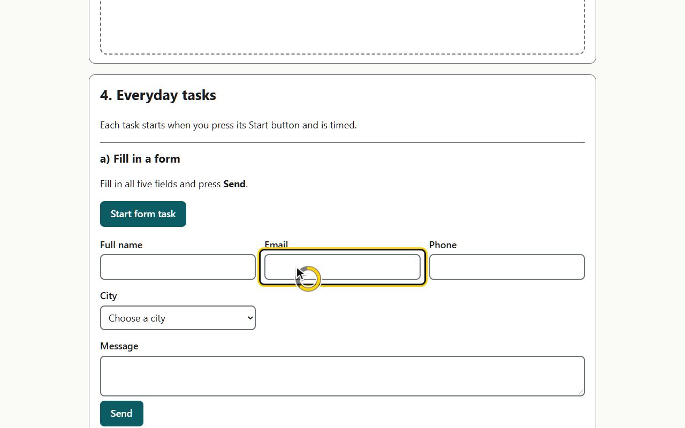
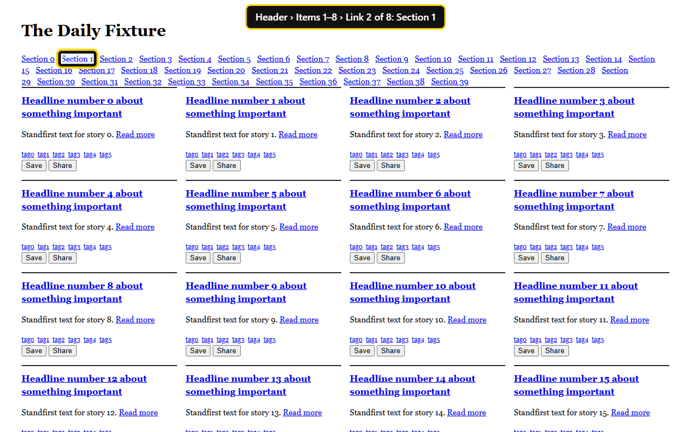
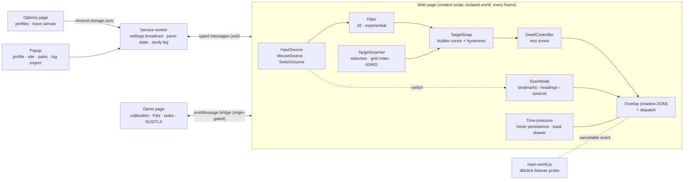

# Steady

**A Chrome extension that makes the web usable for people with tremor, slowed movement, and progressively declining motor control, such as Parkinson's disease and ALS.**

Steady smooths a shaky cursor, snaps it to the nearest button, clicks when you hold still, keeps hover menus and pop-up messages from vanishing, and lets people with no hand use drive the web with a single switch. It runs entirely in your browser, sends no data anywhere, and turns itself off (**Ctrl+Shift+S**) the moment you want the page back.

| Tremor smoothing | Target snap | Dwell click | Switch scanning |
| --- | --- | --- | --- |
|  |  |  |  |

<!-- TODO(owner): replace with GIFs recorded from docs/DEMO_SCRIPT.md shots 5–7. -->

## Features

- **Tremor-filtered cursor.** A 1€ adaptive filter: steady when you move slowly, responsive when you move deliberately. Steady draws its own "ghost" cursor at the filtered position and can hide the system cursor.
- **Target assist.** Bubble-cursor snapping to the nearest control, with anti-flicker hysteresis, an optionally enlarged catch area, and clicks that fire on *release* (slide away to cancel).
- **Dwell click.** Hold still to click, with a visible countdown ring. *Rest zones* stop the page being clicked while you rest your hand. **Esc** cancels.
- **Take your time.** Hover menus stay open while you head toward them (triangle of intent); vanishing pop-up messages are kept in a *Page messages* panel; optional one-click-equals-double-click per site.
- **Switch scanning.** One switch (short press = next, long press = select), two switches, or automatic scanning, through landmarks → headings → controls, with a spoken breadcrumb. Gamepad-button switches work too.
- **Profiles.** Ships *Steady (mild)*, *Steady (strong)*, and *Rest mode*. Duplicate, rename, and import/export them (for caregivers and OTs). Quick switching from the toolbar.
- **Fail open.** Any error removes Steady from the page. Per-site and per-tab off switches.
- **Research-ready.** A demo page with calibration, an ISO 9241-9 Fitts task, everyday tasks, SUS and NASA-TLX, JSON export, and an opt-in local study log.

## Install

**From source (now):**

```bash
npm ci
npm run build
```

Then open `chrome://extensions`, turn on **Developer mode**, click **Load unpacked**, and choose the `dist/` folder.

**Chrome Web Store:** `npm run package` produces `steady-<version>.zip` for upload. The privacy policy is at `src/demo/privacy.html` (published with the demo).

## Try the demo

```bash
node scripts/serve.mjs
```

Open <http://localhost:4173/>. Section 1 lets you add a simulated 5 Hz tremor and see Steady remove it. The demo is also deployed to GitHub Pages by `.github/workflows/pages.yml`.

> After publishing, add your Pages origin to `DEMO_ORIGINS` in `src/shared/config.ts`: the demo bridge only talks to trusted hosts.

## Architecture



The pipeline order is fixed: **InputSource → Filter → TargetSnap → DwellController → Overlay + dispatch.** Every stage is a small class with its own unit tests.

```
src/
  background/service-worker.ts   settings init/broadcast, per-tab panic, study-log buffer
  content/
    index.ts                     bootstrap: decides whether to run, owns the Pipeline
    pipeline.ts                  wires the stages; guards every page hook (fail open)
    input/                       InputSource, MouseSource, SwitchSource
    filters/                     OneEuroFilter, ExponentialFilter
    targets/                     scanner (spatial index), snap (bubble cursor)
    dwell/DwellController.ts     pure dwell/rest state machine
    timepressure/                hover persistence (triangle of intent), toast watcher
    scan/                        switch-scanning tree, controller, mode
    overlay/                     shadow-DOM ghost cursor, rings, drawer, option picker
    bridge.ts                    demo-page bridge (origin-gated)
    main-world.ts                dblclick-listener detection (MAIN world)
  options/  popup/  shared/  demo/
test/unit (vitest)  test/e2e (playwright)  test/fixtures
docs/  DESIGN_LOG · TESTING · STUDY_PROTOCOL · CASE_STUDY · DEMO_SCRIPT
```

## Development

```bash
npm run dev          # rebuild on change (then reload the extension)
npm run typecheck && npm run lint && npm test
npm run test:e2e     # builds, then runs Playwright with the extension loaded
npm run package      # Web Store zip
npm run screenshots  # regenerate docs/store/*.png
npm run realsites    # smoke-test on a news site, a form, and a hover-menu app
```

Branded Google Chrome ≥ 137 ignores `--load-extension`, so e2e tests use Playwright's Chromium. On Windows, if that fails to start, point `STEADY_CHROME` at a Chrome for Testing binary (see [docs/TESTING.md](docs/TESTING.md)).

CI (`.github/workflows/ci.yml`) runs typecheck, lint, unit tests, build, and e2e on every push.

## Running the study

1. Read [docs/STUDY_PROTOCOL.md](docs/STUDY_PROTOCOL.md): recruitment text, consent, a minute-by-minute script, the interview guide, and the analysis plan.
2. In Steady's options, turn on **Research study logging** and set a participant ID (only with consent).
3. On the demo page: set the participant ID and condition order (alternate A/B), then run the pointing task, the everyday tasks, and the questionnaires in each condition.
4. Export: **Download session (JSON)** on the demo page, and **Export log** in the Steady popup.

## Privacy

Steady makes no network requests and collects no analytics. Settings live in `chrome.storage.sync`; the opt-in study log lives only in `chrome.storage.local` and never contains URLs or page text. See [the privacy policy](src/demo/privacy.html).

## Credits and references

1€ filter (Casiez, Roussel & Vogel, CHI 2012) · Bubble cursor (Grossman & Balakrishnan, CHI 2005) · Midas touch (Jacob, CHI 1990) · ISO 9241-9 (Soukoreff & MacKenzie, IJHCS 2004) · WCAG 2.2.

Design history and every decision: [docs/DESIGN_LOG.md](docs/DESIGN_LOG.md). Case study: [docs/CASE_STUDY.md](docs/CASE_STUDY.md).

## License

MIT
